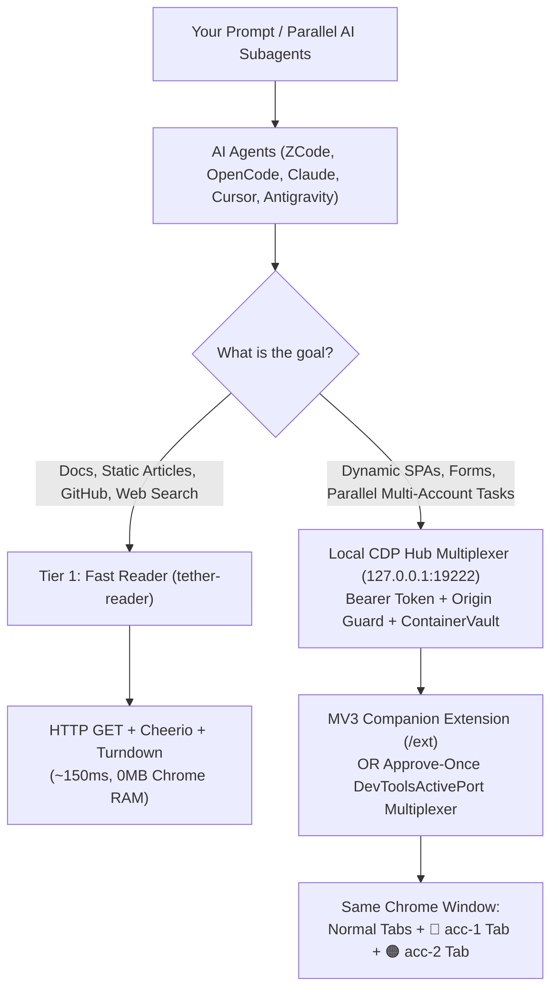

# 🌐 ChromeTether

> **Dual-tier web browsing, live Chrome automation, and Firefox-style same-window Multi-Account Container Tabs for AI coding assistants and autonomous agents via Model Context Protocol (MCP).**

[](LICENSE)
[](https://nodejs.org)
[](https://modelcontextprotocol.io)

**ChromeTether** equips your AI agents (ZCode, OpenCode, Claude Code, Claude Desktop, Cursor, Windsurf, Cline, DeepSeek Harness/dsh, Antigravity) with a comprehensive web browsing and multi-account automation system:
1. **Tier 1 (Fast Reader — `tether-reader`)**: Instant HTTP fetching and Markdown conversion (~150ms, 0MB RAM) for static docs, blogs, and organic DuckDuckGo search without starting a browser.
2. **Tier 2 (Live Chrome Attachment — `chrome-devtools` + Local CDP Hub)**: Direct Chrome DevTools Protocol (CDP) control attaching to your **currently open Google Chrome window** via a persistent **Local CDP Hub Multiplexer** (`127.0.0.1:19222`) and **MV3 Companion Extension** (`extension/`) so you are never spammed by repeated *"Allow remote debugging?"* prompts across agent sessions.
3. **Same-Window Multi-Account Container Tabs (`tether-containers`)**: Open multiple isolated accounts (`🔵 acc-1`, `🟠 acc-2`) as tabs inside the **exact same Chrome window** using Chrome Tab Groups, Manifest V3 `declarativeNetRequest` (`tabIds`) cookie isolation, and `ContainerVault` storage virtualization (`document.cookie`, `cookieStore`, `localStorage`, `sessionStorage`).

---

## 🌟 Architecture & Core Features



### 1. Dual-Tier + Multi-Container Workflow

| Component | Tools | Underlying Engine | Best Used For |
| :--- | :--- | :--- | :--- |
| **Tier 1: Fast Reader (`tether-reader`)** | `read_url_content(url)`, `search_web(query, max_results, domain)` | Lightweight HTTP GET + Cheerio + Turndown + DuckDuckGo (HTML + Lite fallback) | Reading documentation, API specs, blogs, GitHub issues/READMEs, JSON/XML/plain text, and organic search (with optional `domain` filtering and ad/tracking removal). Runs in **~150ms** with **zero browser overhead**. |
| **Tier 2: Live Chrome (`chrome-devtools`)** | `navigate_page`, `new_page`, `click`, `fill`, `take_snapshot`, `take_screenshot`, `list_console_messages`, `list_network_requests` | Google `chrome-devtools-mcp@1.9.0` routed through ChromeTether Local CDP Hub | Dynamic SPAs (React, Next.js, Vue), web apps, filling forms, submitting data, inspecting UI, diagnosing console errors, and capturing screenshots. |
| **Container Tabs (`tether-containers`)** | `list_containers`, `create_container`, `open_container_page`, `clear_container` | MV3 `declarativeNetRequest` (`tabIds`) + `chrome.tabGroups` + `ContainerVault` (`~/.chrometether/containers.json`) | Running 2+ accounts on the same website simultaneously in the **same Chrome window** without overwriting your default profile cookies or opening separate windows. |
| **Application Map (`tether-map`)** | `start_app_map`, `record_app_page`, `record_app_requests`, `get_app_map` | Local endpoint normalizer & persistent store (`~/.chrometether/app-map.json`) | Mapping visited pages and observed API endpoints during authorized web application exploration. |

### 2. Eliminating Repeated *"Allow remote debugging?"* Prompts (Local CDP Hub)
Chrome 144+ displays a native modal confirmation dialog every time a new CDP client connects to `DevToolsActivePort`. Because standard MCP stdio servers restart on every chat session or subagent spawn, users normally get spammed with popups. ChromeTether solves this in two ways:
* **Phase 0 (Approve-Once `DevToolsActivePort` Multiplexer)**: The background Local Hub (`src/cdp-hub/server.js`) holds **one single persistent connection** to Chrome and multiplexes any number of concurrent MCP clients over it, replaying target discovery and `Runtime` execution contexts automatically.
* **Phase 1 (MV3 Companion Extension — Zero Modal Dialogs)**: Load the unpacked extension from [`extension/`](extension/) in `chrome://extensions`. It connects outbound to `ws://127.0.0.1:19222/ext` (with a 20-second keep-alive heartbeat) using `chrome.debugger`, which **never** triggers the *"Allow remote debugging?"* modal prompt.

### 3. Firefox-Style Multi-Account Container Tabs in One Chrome Window (`tether-containers`)
Instead of opening separate Chrome windows for each isolated context, ChromeTether lets you and your AI agents open color-coded Container Tabs (`🔵 acc-1`, `🟠 acc-2`, `🟢 work`) right inside your active Chrome window:
* **Zero Default-Jar Pollution**: Uses Manifest V3 `declarativeNetRequest` session rules scoped by `tabIds` to strip `Set-Cookie` headers from container responses *before* Chrome commits them to your default profile cookie jar, while capturing raw `Set-Cookie` headers into `~/.chrometether/containers.json` (`0o600` atomic writes).
* **Deterministic Cookie & Storage Isolation**: Injects per-container `Cookie` headers at the network layer (`modifyHeaders` `set`) and virtualizes `document.cookie`, `window.cookieStore`, `localStorage`, and `sessionStorage` via `Page.addScriptToEvaluateOnNewDocument`, with HTTP cache and site service workers disabled in container tabs.
* **Fail-Closed Detach Safety**: If `chrome.debugger` detaches unexpectedly on a container tab, the extension immediately re-attaches or engages a fail-closed `declarativeNetRequest` block rule for that `tabId` so it never leaks requests with default cookies.
* **3 Ways for Agents to Open Container Tabs**:
  1. Call `open_container_page({ container: "acc-1", url: "https://example.com", background: true })` from `tether-containers`.
  2. Call `create_container({ name: "acc-1", color: "blue" })` followed by `new_page({ url: "https://example.com", isolatedContext: "acc-1" })`.
  3. Pass a URL fragment hint: `new_page({ url: "https://example.com#tether-container=acc-1" })`.

### 4. Token-Efficient Interaction (`uid`)
* Avoids context-window blowouts caused by dumping raw HTML.
* Uses Chrome's **Accessibility Tree** where every interactive button, input, and link is assigned a numeric `uid` (e.g. `[uid: 10] button "Submit"`).
* Always pass `pageId` (from `list_pages()`) when driving multiple container tabs concurrently so parallel agents never steal focus from each other.

### 5. Application Map (`tether-map`)

The installer also registers `tether-map`, a local MCP server for building a reusable map of an application while an agent explores it in Chrome. It groups observed requests by method and URL path (for example, `/api/orders/123` and `/api/orders/456` become `GET /api/orders/{id}`), then records status codes, query parameter **names**, and the page where each endpoint was seen.

Ask your agent: **“Map the pages and API requests you observe while exploring https://app.example.com.”** The workflow is:

1. `start_app_map(target_url)`; include `allowed_origins` if the application uses a separate API origin.
2. Navigate with `chrome-devtools`, then call `record_app_page(page_url, title)` for visited pages.
3. Call Chrome DevTools `list_network_requests({includePreservedRequests: true})` and pass the observed URL, method, status, and resource type to `record_app_requests(page_url, requests)`. Calls accept up to 200 requests.
4. Call `get_app_map({kind: "api"})` to focus on API endpoints. Use `endpoint_offset`, `page_offset`, and `limit` to page through the saved map (50 items per group by default, at most 100).

---

## 🚀 1-Click Installation

### Option 1: PowerShell Script (Windows)
Clone the repository and run:

```powershell
git clone https://github.com/toannguyen3107/chrometether.git
cd chrometether
npm install
.\scripts\setup.ps1
```

### Option 2: CLI Command (Cross-Platform)

```bash
git clone https://github.com/toannguyen3107/chrometether.git
cd chrometether
npm install

# Check status of detected agent environments
node bin/chrometether.js status

# Automatically configure all detected agents
node bin/chrometether.js install all

# Manage Multi-Account Containers & Local CDP Hub
node bin/chrometether.js containers create acc-1 blue
node bin/chrometether.js containers create acc-2 orange
node bin/chrometether.js containers list
node bin/chrometether.js hub status
```

---

## ⚙️ Setting Up Google Chrome (Extension or Remote Debugging)

### Method A (Recommended — Companion Chrome Extension for Container Tabs & Zero Modal Prompts)
1. Open Google Chrome and navigate to `chrome://extensions`.
2. Enable **Developer mode** (top-right toggle).
3. Click **Load unpacked** and select the [`extension/`](extension/) folder inside your `chrometether` directory.
4. Click the **ChromeTether Containers** icon in your toolbar anytime to open new color-coded Container Tabs (`🔵 acc-1`, `🟠 acc-2`) or convert the current tab.

### Method B (Built-In Chrome Inspect — Phase 0 Multiplexer)
1. Open Google Chrome and navigate to `chrome://inspect/#remote-debugging`.
2. Check **"Enable remote debugging"** (or launch Chrome with `--remote-debugging-port=9222`).
3. Approve the connection once — the ChromeTether Local Hub keeps that single approved connection alive across all future MCP sessions.

---

## 🤖 Supported Agent Integrations

| Agent | Config File | Features Added |
| :--- | :--- | :--- |
| **ZCode (Z.ai)** | `~/.zcode/cli/config.json` | Registers `chrome-devtools`, `tether-reader`, `tether-map`, and `tether-containers`. Installs `/browser` slash command and browser skills. |
| **OpenCode CLI** | `~/.config/opencode/opencode.jsonc` | Merged using OpenCode MCP array schema routed through the Local Hub launcher. |
| **Claude Code CLI** | `~/.claude.json` | MCP configuration + installs browser skills in `~/.claude/skills/`. |
| **Claude Desktop** | `claude_desktop_config.json` | MCP configuration routed through the Local Hub launcher. |
| **Cursor IDE** | `~/.cursor/mcp.json` | Cursor MCP server registration (`chrome-devtools`, `tether-reader`, `tether-map`, `tether-containers`). |
| **Windsurf (Codeium)** | `~/.codeium/windsurf/mcp_config.json` | Cascade MCP server registration. |
| **Roo Code / Cline** | `cline_mcp_settings.json` | VS Code extension MCP configuration (shallow-merged to preserve `alwaysAllow` / `env`). |
| **Google Antigravity (AGY)** | `~/.gemini/config/mcp_config.json` + `~/.gemini/config/plugins/agy-browser/` | Merges `tether-reader`, `tether-map`, and `tether-containers` (skipping duplicate `chrome_devtools`) and installs plugin skills/rules. |
| **DeepSeek Harness (dsh)** | `~/.dsh/profiles/web/cordis.patch.yml` | Configures `dsh` MCP client profile, skills, and `AGENTS.md`. |

> **Environment Variables**:
> * `CHROMETETHER_NODE_COMMAND`: Override the Node executable written to MCP configs (defaults to `process.execPath`).
> * `CHROMETETHER_HOME`: Override the home directory inspected by `status`, `install`, and default `~/.chrometether/` storage.
> * `CHROMETETHER_HUB_PORT`: Override the Local CDP Hub port (defaults to `19222`).
> * `CHROMETETHER_CONTAINERS_FILE`: Override the default `~/.chrometether/containers.json` vault path.
> * `CHROMETETHER_MAP_FILE`: Override the default `~/.chrometether/app-map.json` storage path.

---

## 🧪 Verification & Diagnostics

Run the comprehensive test suite (74 unit & integration tests):
```bash
npm test
```
Tests verify:
* RFC 6265 Cookie Jar parsing, domain/path matching, and `declarativeNetRequest` (`tabIds`) session rule generation (`test/container-vault.test.js`).
* Local CDP Hub Bearer token + Origin security guard, Phase 0 multiplexer, Extension `/ext` container tab lifecycle, and real `puppeteer-core@25.10.0` handshake + multi-session `Runtime` state replay (`test/cdp-hub.test.js`).
* Fast Reader HTML-to-Markdown conversion and DuckDuckGo organic search (`test/fetch-markdown.test.js`, `test/search-ddg.test.js`).
* `tether-reader`, `tether-map`, and `tether-containers` MCP server handlers.
* Safe shallow-merging of agent configuration files (`test/config-merger.test.js`, `test/cli-install.test.js`).

---

## 🔒 Security & Privacy

* **Authenticated Local Hub**: Connections to `ws://127.0.0.1:19222/cdp` require a per-install random Bearer token (`~/.chrometether/hub-token`, `0o600` permissions) and reject browser `http(s)://` `Origin` headers to prevent cross-origin WebSocket hijacking from visited websites.
* **Restricted Container Vault**: `~/.chrometether/containers.json` is written atomically with `0o600` permissions and prunes expired and session-only cookies automatically.
* **Safe Config Merging**: The installer shallow-merges existing server entries (preserving custom `env`, `disabled`, `alwaysAllow`, and `autoApprove` settings) and creates timestamped `.bak` backups before modifying any configuration file.

---

## 📄 License

[MIT License](LICENSE) © 2026 Toan Nguyen
