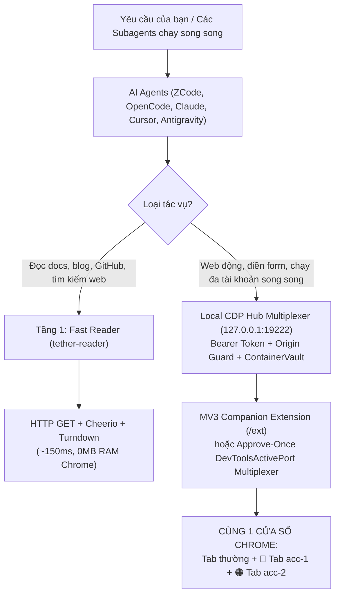

# 🌐 ChromeTether

> **Bộ toolkit duyệt web 2 tầng, điều khiển Chrome trực tiếp (0-Popup Hub) và chia Multi-Account Container Tabs ngay trên cùng 1 cửa sổ Chrome cho AI Agent qua giao thức MCP (Model Context Protocol).**

[](LICENSE)
[](https://nodejs.org)
[](https://modelcontextprotocol.io)

**ChromeTether** trang bị cho các AI coding assistant (ZCode, OpenCode, Claude Code, Claude Desktop, Cursor, Windsurf, Cline, dsh, Antigravity) hệ thống duyệt web và tự động hóa đa tài khoản toàn diện:
1. **Tầng 1 (Fast Reader — `tether-reader`)**: Bóc tách nội dung HTML sang Markdown siêu nhanh (~150ms, 0MB RAM) và tìm kiếm DuckDuckGo sạch quảng cáo mà không cần bật trình duyệt.
2. **Tầng 2 (Điều khiển Chrome trực tiếp — `chrome-devtools` + Local CDP Hub)**: Kết nối thẳng vào **cửa sổ Google Chrome bạn đang mở** thông qua **Local CDP Hub Multiplexer** (`127.0.0.1:19222`) và **MV3 Companion Extension** (`extension/`), triệt tiêu hoàn toàn hộp thoại hỏi quyền *"Allow remote debugging?"* lặp đi lặp lại mỗi khi mở phiên AI mới.
3. **Multi-Account Container Tabs trong cùng 1 cửa sổ Chrome (`tether-containers`)**: Mở nhiều tab cô lập tài khoản (`🔵 acc-1`, `🟠 acc-2`, `🟢 work`) **ngay trong cùng cửa sổ Chrome hiện tại** (tương tự Firefox Multi-Account Containers) bằng `chrome.tabGroups`, cô lập Cookie ở tầng mạng bằng Manifest V3 `declarativeNetRequest` (`tabIds`) và cô lập `document.cookie`, `cookieStore`, `localStorage`, `sessionStorage` qua `ContainerVault`.

---

## 🌟 Kiến trúc & Tính năng cốt lõi



### 1. Hệ sinh thái 4 MCP Servers phối hợp

| Thành phần | Công cụ (MCP Tools) | Cơ chế hoạt động | Ưu điểm & Trường hợp sử dụng |
| :--- | :--- | :--- | :--- |
| **Tầng 1: Đọc nhanh (`tether-reader`)** | `read_url_content(url)`, `search_web(query, max_results, domain)` | HTTP GET + Cheerio + Turndown + DuckDuckGo (HTML + Lite fallback) | Đọc tài liệu lập trình, blog, GitHub README, JSON/XML/plain text, tìm kiếm DuckDuckGo nhanh (lọc quảng cáo, ưu tiên `domain`). Tốn **0MB RAM**, phản hồi **~150ms**. |
| **Tầng 2: Chrome trực tiếp (`chrome-devtools`)** | `navigate_page`, `new_page`, `click`, `fill`, `take_snapshot`, `take_screenshot`, `list_console_messages`, `list_network_requests` | `chrome-devtools-mcp@1.9.0` kết nối qua ChromeTether Local CDP Hub | Tương tác Single Page App (React, Next.js, Vue), điền form, click nút, chụp ảnh màn hình, kiểm tra lỗi Console & Network API. |
| **Container Tabs (`tether-containers`)** | `list_containers`, `create_container`, `open_container_page`, `clear_container` | MV3 `declarativeNetRequest` (`tabIds`) + `chrome.tabGroups` + `ContainerVault` (`~/.chrometether/containers.json`) | Đăng nhập và điều khiển song song 2+ tài khoản trên cùng 1 trang web **ngay trong cùng cửa sổ Chrome**, không làm mất phiên đăng nhập ở tab thường và không mở cửa sổ mới. |
| **Bản đồ ứng dụng (`tether-map`)** | `start_app_map`, `record_app_page`, `record_app_requests`, `get_app_map` | Gom nhóm URL & lưu trữ cục bộ (`~/.chrometether/app-map.json`) | Lập bản đồ các trang đã đi qua và các API endpoint quan sát được khi khảo sát ứng dụng web. |

### 2. Triệt tiêu Popup *"Allow remote debugging?"* lặp lại (Local CDP Hub)
Trên Chrome 144+, mỗi kết nối mới vào `DevToolsActivePort` đều bật hộp thoại hỏi quyền. Vì các MCP server chạy theo từng phiên chat/subagent, bạn sẽ bị hỏi liên tục. ChromeTether giải quyết triệt để qua 2 tầng:
* **Phase 0 (Approve-Once `DevToolsActivePort` Multiplexer)**: Tiến trình ngầm Local Hub (`src/cdp-hub/server.js`) giữ **duy nhất 1 kết nối WebSocket đã duyệt** tới Chrome và chia sẻ (multiplex) cho mọi tiến trình MCP kết nối vào, tự động replay danh sách tab và `Runtime` execution contexts.
* **Phase 1 (MV3 Companion Extension — 0 Hộp thoại Modal)**: Nạp extension từ thư mục [`extension/`](extension/) trong `chrome://extensions`. Extension chủ động mở kết nối từ trong Chrome ra `ws://127.0.0.1:19222/ext` (kèm nhịp ping 20 giây giữ MV3 Service Worker luôn sống) bằng API `chrome.debugger`, giúp Chrome **không bao giờ** bật hộp thoại *"Allow remote debugging?"*.

### 3. Multi-Account Container Tabs trong cùng 1 cửa sổ Chrome (`tether-containers`)
Thay vì mở cửa sổ Chrome mới cho mỗi profile, ChromeTether cho phép bạn và AI mở các Tab cô lập có gắn nhãn màu (`🔵 acc-1`, `🟠 acc-2`, `🟢 work`) ngay trên thanh tab của cửa sổ hiện tại:
* **Bảo vệ tuyệt đối phiên đăng nhập gốc**: Dùng Manifest V3 `declarativeNetRequest` session rules khóa theo `tabIds` để gỡ header `Set-Cookie` trên các tab container **trước** khi Chrome ghi vào Cookie Jar mặc định của trình duyệt, đồng thời bắt `Set-Cookie` nguyên bản lưu vào `~/.chrometether/containers.json` (ghi atomic với quyền `0o600`).
* **Cô lập Cookie & Storage theo từng Tab**: Tự động gắn header `Cookie` riêng của từng container ở tầng mạng (`modifyHeaders` `set`) và ảo hóa `document.cookie`, `window.cookieStore`, `localStorage`, `sessionStorage` qua `Page.addScriptToEvaluateOnNewDocument`, đồng thời tắt HTTP cache và Service Worker trong các tab container.
* **Cơ chế Fail-Closed an toàn**: Nếu `chrome.debugger` bị ngắt kết nối bất ngờ trên một tab container, extension lập tức tự gắn lại hoặc kích hoạt rule DNR `block` cho `tabId` đó để không bao giờ rò rỉ request bằng cookie mặc định.
* **3 Cách để AI Agent mở Tab Container**:
  1. Gọi `open_container_page({ container: "acc-1", url: "https://example.com", background: true })` từ MCP `tether-containers`.
  2. Gọi `create_container({ name: "acc-1", color: "blue" })` rồi gọi `new_page({ url: "https://example.com", isolatedContext: "acc-1" })`.
  3. Truyền trực tiếp hậu tố URL: `new_page({ url: "https://example.com#tether-container=acc-1" })`.

### 4. Tương tác chính xác qua Accessibility Tree `uid` & `pageId`
* Dùng cây trợ năng (Accessibility Tree) của Chrome với mã số `uid` cho từng nút bấm/ô nhập liệu (`fill(14, "email@example.com")`, `click(10)`).
* Khi chạy nhiều tác vụ song song trên nhiều tab container, các AI agent truyền `pageId` (lấy từ `list_pages()`) vào mọi lệnh để thao tác ngầm (`background: true`) mà không cướp focus chuột/bàn phím của nhau.

---

## 🚀 Cài đặt nhanh 1-Click

### Cách 1: PowerShell Script (Windows)
Clone repo về máy và chạy:

```powershell
git clone https://github.com/toannguyen3107/chrometether.git
cd chrometether
npm install
.\scripts\setup.ps1
```

### Cách 2: Lệnh CLI (Đa nền tảng)

```bash
git clone https://github.com/toannguyen3107/chrometether.git
cd chrometether
npm install

# Kiểm tra trạng thái các AI agent trên máy
node bin/chrometether.js status

# Tự động cấu hình tất cả AI agent phát hiện được
node bin/chrometether.js install all

# Quản lý Multi-Account Containers & Local CDP Hub
node bin/chrometether.js containers create acc-1 blue
node bin/chrometether.js containers create acc-2 orange
node bin/chrometether.js containers list
node bin/chrometether.js hub status
```

---

## ⚙️ Cài đặt trên Google Chrome (Extension hoặc Remote Debugging)

### Cách 1 (Khuyên dùng — Nạp ChromeTether Extension để có Container Tabs & Không hỏi Popup)
1. Mở Google Chrome, truy cập `chrome://extensions`.
2. Bật công tắc **Developer mode** (Chế độ dành cho nhà phát triển) ở góc trên bên phải.
3. Bấm **Load unpacked** (Tải tiện ích đã giải nén) và chọn thư mục [`extension/`](extension/) nằm trong thư mục `chrometether`.
4. Bạn có thể bấm vào biểu tượng **ChromeTether Containers** trên thanh công cụ bất cứ lúc nào để mở nhanh Tab Container mới (`🔵 acc-1`, `🟠 acc-2`) hoặc chuyển đổi tab hiện tại sang Container.

### Cách 2 (Dùng `chrome://inspect` sẵn có — Phase 0 Multiplexer)
1. Mở Google Chrome, truy cập `chrome://inspect/#remote-debugging`.
2. Tích chọn **"Enable remote debugging"** (hoặc khởi động Chrome với `--remote-debugging-port=9222`).
3. Chỉ cần bấm Allow 1 lần duy nhất — Local CDP Hub sẽ giữ kết nối đó cho mọi phiên làm việc tiếp theo.

---

## 🤖 Các AI Agent được hỗ trợ

| Agent | File cấu hình | Tính năng được tích hợp |
| :--- | :--- | :--- |
| **ZCode (Z.ai)** | `~/.zcode/cli/config.json` | Đăng ký `chrome-devtools`, `tether-reader`, `tether-map` và `tether-containers`. Cài lệnh `/browser` cùng bộ browser skills. |
| **OpenCode CLI** | `~/.config/opencode/opencode.jsonc` | Tự động merge theo chuẩn mảng `command` của OpenCode kết nối qua Local Hub launcher. |
| **Claude Code CLI** | `~/.claude.json` | Cấu hình MCP + tự động sao chép skills vào `~/.claude/skills/`. |
| **Claude Desktop** | `claude_desktop_config.json` | Tự động merge cấu hình stdio MCP qua Local Hub launcher. |
| **Cursor IDE** | `~/.cursor/mcp.json` | Cấu hình MCP cho Cursor (`chrome-devtools`, `tether-reader`, `tether-map`, `tether-containers`). |
| **Windsurf (Codeium)** | `~/.codeium/windsurf/mcp_config.json` | Cấu hình MCP cho Cascade. |
| **Roo Code / Cline** | `cline_mcp_settings.json` | Cấu hình MCP cho extension VS Code (shallow-merge bảo toàn `alwaysAllow` / `env`). |
| **Google Antigravity (AGY)** | `~/.gemini/config/mcp_config.json` + `~/.gemini/config/plugins/agy-browser/` | Đăng ký `tether-reader`, `tether-map`, `tether-containers` (bỏ qua `chrome_devtools` nếu đã có sẵn) và cài đặt bộ plugin skills/rules. |
| **DeepSeek Harness (dsh)** | `~/.dsh/profiles/web/cordis.patch.yml` | Cấu hình MCP client profile, skills và `AGENTS.md` cho `dsh`. |

> **Biến môi trường hỗ trợ**:
> * `CHROMETETHER_NODE_COMMAND`: Ghi đè đường dẫn thực thi Node trong cấu hình MCP (mặc định dùng `process.execPath`).
> * `CHROMETETHER_HOME`: Ghi đè thư mục home khi chạy `status`, `install` và nơi lưu `~/.chrometether/`.
> * `CHROMETETHER_HUB_PORT`: Đổi cổng của Local CDP Hub (mặc định `19222`).
> * `CHROMETETHER_CONTAINERS_FILE`: Đổi đường dẫn lưu file dữ liệu Container Vault (mặc định `~/.chrometether/containers.json`).
> * `CHROMETETHER_MAP_FILE`: Đổi đường dẫn lưu file bản đồ ứng dụng (mặc định `~/.chrometether/app-map.json`).

---

## 🧪 Kiểm tra & Chẩn đoán sức khỏe

Chạy toàn bộ 74 bài kiểm thử đơn vị và tích hợp:
```bash
npm test
```
Bộ test xác minh:
* Bộ phân tích Cookie chuẩn RFC 6265, cô lập dữ liệu giữa `acc-1` và `acc-2`, và bộ sinh rule `declarativeNetRequest` theo `tabIds` (`test/container-vault.test.js`).
* Bảo mật Bearer Token & Origin Guard của Local CDP Hub, Phase 0 Multiplexer, kết nối Extension `/ext`, và kiểm thử tương thích thực tế với `puppeteer-core@25.10.0` kèm cơ chế replay `Runtime` contexts (`test/cdp-hub.test.js`).
* Chuyển đổi HTML sang Markdown của Fast Reader và tìm kiếm DuckDuckGo (`test/fetch-markdown.test.js`, `test/search-ddg.test.js`).
* Hoạt động của các MCP server `tether-reader`, `tether-map`, `tether-containers`.
* Cơ chế shallow-merge bảo toàn cấu hình người dùng của bộ cài đặt (`test/config-merger.test.js`, `test/cli-install.test.js`).

---

## 🔒 Bảo mật & An toàn

* **Xác thực Local Hub (Token + Origin Guard)**: Mọi kết nối tới `ws://127.0.0.1:19222/cdp` đều yêu cầu Bearer token ngẫu nhiên tạo riêng cho máy của bạn (`~/.chrometether/hub-token`, quyền `0o600`) và từ chối mọi kết nối có header `Origin: http(s)://...` từ các trang web bên ngoài.
* **Bảo vệ Container Vault**: File `~/.chrometether/containers.json` được ghi dạng atomic (`.tmp` + `rename`) với quyền `0o600` và tự động dọn dẹp các cookie hết hạn.
* **Sao lưu & Shallow-Merge tự động**: Trình cài đặt luôn tạo bản sao lưu `.bak` kèm timestamp và giữ nguyên các thuộc tính tùy chỉnh (`env`, `disabled`, `alwaysAllow`, `autoApprove`) trong file cấu hình của bạn.

---

## 📄 Bản quyền

Phát hành theo giấy phép [MIT License](LICENSE) © 2026 Toan Nguyen.
