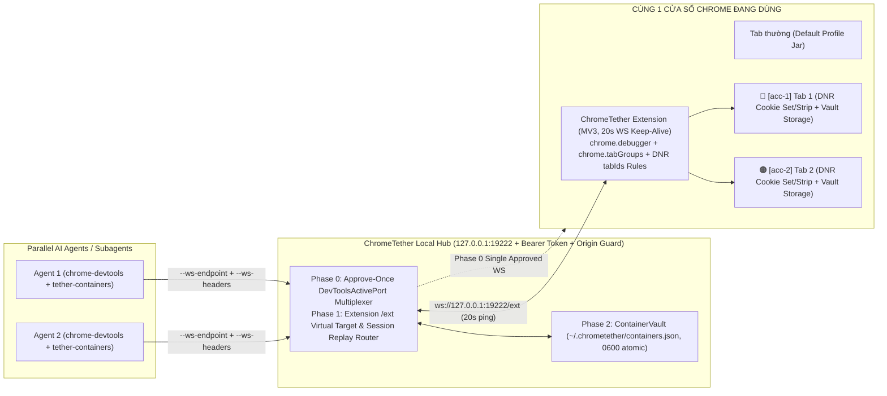

# Kế hoạch Kiến trúc & Hiện thực (v2 — Đã cập nhật theo Review của Claude Fable 5.1): Multi-Account Container Tabs (Cùng 1 Cửa sổ Chrome) & Bypass Popup "Allow remote debugging?"

> **Trạng thái Review**: Đã được review bởi **Claude Fable 5.1** (`task_16375f869c37` / `ctx_35e519266b38` trong Orca run `run_3fbd0ce7f7a3`) tại [`docs/superpowers/plans/2026-10-31-fable-review.md`](file:///C:/Users/minht/orca/workspaces/chrometether/hydra/docs/superpowers/plans/2026-10-31-fable-review.md). Bản v2 này tích hợp toàn bộ các điều chỉnh B1–B3, H1–H5, M1–M4 và L1–L2 từ Fable.

---

## 1. Các thay đổi thiết kế trọng tâm từ Fable Review

| Mã Finding | Vấn đề Fable phát hiện | Giải pháp kiến trúc trong v2 |
|---|---|---|
| **Phase 0 First** | Multiplexer qua `DevToolsActivePort` là giải pháp ít rủi ro nhất để bỏ lặp lại popup *"Allow remote debugging?"* và nên là nền tảng Phase 0 trước khi thêm Extension transport (Phase 1). | Hub (`src/cdp-hub/server.js`) tích hợp cả **Phase 0 (Approve-once `DevToolsActivePort` Multiplexer)** lẫn **Phase 1 (Extension `/ext` Transport)** chung một kiến trúc. |
| **B1 & B3 (Blocking)** | Chặn `Set-Cookie` ở CDP `Fetch` response stage là quá muộn (Chrome đã ghi vào default cookie jar làm mất phiên đăng nhập của user); chèn `Cookie` ở `Fetch.continueRequest` có thể xung đột với cookie jar mặc định. | Chuyển tầng chèn `Cookie` và gỡ `Set-Cookie` sang **Manifest V3 `declarativeNetRequest` (DNR) session rules theo `tabIds`** trong Extension (`modifyHeaders` `set` cho request `Cookie` chạy sau khi jar gắn cookie, và `remove` cho response `Set-Cookie` chạy trước khi jar lưu cookie), kết hợp `webRequest.onHeadersReceived` (`extraHeaders`) / `Network.responseReceivedExtraInfo` để thu thập `Set-Cookie` nguyên bản vào `ContainerVault`. |
| **B2 (Blocking)** | Tên `isolatedContext` trong `new_page(isolatedContext="acc-1")` được `chrome-devtools-mcp` giữ trong RAM chứ không gửi qua lệnh CDP `Target.createBrowserContext {}`. | Bổ sung: (1) MCP Server nhẹ **`tether-containers`** (`list_containers`, `create_container`, `open_container_page`, `clear_container`) + cơ chế **Pending Context Reservation** khi gọi `create_container(name)`; (2) Hỗ trợ URL hash hint `#tether-container=<name>` trong `new_page`; (3) Trả danh sách container theo thứ tự cố định trong `Target.getBrowserContexts`. |
| **H1 & M1 (High)** | `chrome.debugger` chỉ cho phép 1 attachment/tab trong khi `chrome-devtools-mcp` + Puppeteer 25.10 cần 2–3 CDP sessions/tab và chờ barrier `tab` → `page` (`#targetsIdsForInit`). | Hub thực thi đúng chuỗi handshake 12 bước của `puppeteer-core@25.10.0`, lọc bỏ các tab không thể attach khỏi discovery barrier, multiplex nhiều virtual sessions trên 1 attachment và **replay trạng thái `Runtime.executionContextCreated`** + ref-count các lệnh `*.enable`/`*.disable`. |
| **H2 & H3 (High)** | Thanh infobar *"started debugging this browser"* khi bấm Cancel hoặc khi MV3 Service Worker ngủ (sau 30s) sẽ làm detach `chrome.debugger`. | (1) Hub ↔ Extension gửi ping/pong mỗi **20 giây** (< 25s) để giữ MV3 Service Worker luôn sống; (2) Thiết kế **Fail-Closed**: khi `chrome.debugger.onDetach` xảy ra trên tab container, tự động re-attach ngay hoặc bật rule DNR `block` cho `tabId` đó để không bao giờ rò rỉ request bằng cookie mặc định. |
| **H4 & M3 (High)** | HTTP cache, Service Worker (`tabId = -1`), `cookieStore`, và `window.open` có thể làm rò rỉ phiên giữa các container. | Tự động gọi `Network.setCacheDisabled({ cacheDisabled: true })` và `Network.setBypassServiceWorker({ bypass: true })` trên mọi tab container; ảo hóa `document.cookie`, `window.cookieStore`, `localStorage`, `sessionStorage` qua `Page.addScriptToEvaluateOnNewDocument`; tự động gán container cha cho tab con mở qua `openerTabId`. |
| **H5 (High)** | WebSocket `ws://127.0.0.1:19222` không có CORS nên trang web bất kỳ có thể kết nối nếu không có xác thực; `containers.json` chứa session cookie. | Sinh token ngẫu nhiên tại `~/.chrometether/hub-token` (`0o600`), truyền qua `--ws-headers '{"Authorization":"Bearer ..."}'` từ MCP và `Sec-WebSocket-Protocol` / message xác thực từ Extension; **chặn mọi kết nối có header `Origin: http(s)://...`**; lưu `containers.json` dạng atomic write (`.tmp` + `rename`) với quyền `0o600`. |
| **M4 & L2 (Medium)** | Hai nơi định nghĩa launch args (`config-merger.js` và `bin/chrometether.js` nhánh `dsh`); `mergeMcpConfig` ghi đè mất cấu hình tùy chỉnh của user; cần pin `chrome-devtools-mcp` `1.9.0`. | Gom nhánh `dsh` dùng chung `getChromeDevToolsLaunch`; sửa `mergeMcpConfig` thành shallow-merge bảo toàn `env`, `disabled`, `timeout`, `alwaysAllow`, `autoApprove`; pin `"chrome-devtools-mcp": "1.9.0"` trong `package.json`. |

---

## 2. Kiến trúc Tổng thể

---

## 3. Chi tiết các thành phần hiện thực

1. **`src/cdp-hub/ws.js`**:
   - Server & Client WebSocket RFC 6455 thuần Node (`node:http`, `node:crypto`, `globalThis.WebSocket`), hỗ trợ frame text/binary/ping/pong/close, kiểm tra `Origin` header và Bearer token.
2. **`src/cdp-hub/container-vault.js`**:
   - Quản lý danh sách Container (`acc-1`, `acc-2`, ...) theo thứ tự xác định (deterministic order), ánh xạ `isolated-context-N` ↔ tên container.
   - Cookie Jar chuẩn RFC 6265 (`domain`, `path`, `secure`, `httpOnly`, `sameSite`, `expires`), lọc cookie hết hạn, xuất danh sách rule `declarativeNetRequest` theo `tabIds` và `requestDomains`.
   - Sinh init script cho `Page.addScriptToEvaluateOnNewDocument` ảo hóa `document.cookie`, `window.cookieStore`, `window.localStorage`, `window.sessionStorage` và chặn `navigator.serviceWorker.register`.
   - Lưu đĩa atomic (`temp` + `rename`, mode `0o600`).
3. **`src/cdp-hub/server.js`**:
   - **HTTP Endpoints** (yêu cầu Bearer token trừ `/health` cơ bản):
     - `GET /health`: trả trạng thái Hub, version, mode (`extension` | `direct` | `standby`), danh sách container.
     - `GET /json/version`, `GET /json/list`: tương thích CDP HTTP discovery.
     - `GET/POST/DELETE /containers`: REST API cho `tether-containers` MCP server và CLI (`list`, `create`, `open-tab`, `clear`, `delete`).
   - **WebSocket `/cdp`**:
     - Phục vụ N tiến trình `chrome-devtools-mcp` song song.
     - Thực thi đầy đủ 12 bước handshake của `puppeteer-core@25.10.0` (bao gồm `Target.getBrowserContexts`, `Browser.getVersion`, `Target.setDiscoverTargets`, `Target.setAutoAttach` với `tab` → `page` hierarchy, multi-session multiplexing, `Runtime.executionContextCreated` state replay, và ref-counting cho `*.enable`/`*.disable`).
     - Hỗ trợ tạo tab container trong **cùng cửa sổ Chrome** qua cả 3 cách: `open_container_page` / `create_container` reservation, `#tether-container=<name>` URL hash, hoặc `Target.createBrowserContext`.
   - **WebSocket `/ext`**:
     - Kết nối với Chrome Extension, gửi ping mỗi 20s để giữ MV3 Service Worker luôn sống, đồng bộ `ContainerVault` và tập rule `declarativeNetRequest` theo `tabIds`.
4. **`src/cdp-hub/launcher.js`**:
   - Wrapper khởi chạy `chrome-devtools-mcp`: tự động bật Hub daemon ngầm (`detached: true, stdio: 'ignore', windowsHide: true`), đợi `/health` sẵn sàng, sau đó truyền `--ws-endpoint=ws://127.0.0.1:19222/cdp` và `--ws-headers={"Authorization":"Bearer <token>"}` vào `chrome-devtools-mcp`.
5. **`src/containers-server/index.js` (`tether-containers` MCP Server)**:
   - Cung cấp 4 MCP tools cho AI Agent:
     - `list_containers()`: Liệt kê các container hiện có, tên `isolatedContext` tương ứng (`isolated-context-1`, ...), màu sắc và danh sách tab.
     - `create_container(name, color)`: Tạo container bền vững và đặt chỗ (pending reservation) cho lần gọi `new_page(isolatedContext)` tiếp theo.
     - `open_container_page(container, url, background)`: Mở trực tiếp 1 Tab cô lập thuộc container `container` ngay trong cửa sổ Chrome hiện tại (gắn nhãn màu Tab Group `🔵 acc-1`) và điều hướng tới `url`.
     - `clear_container(name)`: Xóa sạch cookie và storage của một container.
6. **`extension/` (Manifest V3 Chrome Extension)**:
   - `extension/manifest.json`: quyền `debugger`, `tabs`, `tabGroups`, `cookies`, `storage`, `webRequest`, `declarativeNetRequest`, `declarativeNetRequestWithHostAccess`, `<all_urls>`.
   - `extension/background.js`:
     - Kết nối `ws://127.0.0.1:19222/ext` kèm ping 20s.
     - Tạo tab mới trong cùng cửa sổ (`chrome.tabs.create`), gom nhóm màu (`chrome.tabs.group` + `chrome.tabGroups.update`).
     - Cài đặt **DNR session rules theo `tabIds`**: gỡ `Set-Cookie` khỏi response trước khi chạm vào default cookie jar (fix B1), ghi đè `Cookie` header theo domain cho từng container tab (fix B3), và **Fail-Closed** chặn mạng bằng rule DNR `block` nếu `chrome.debugger` bị detach bất ngờ (fix H2/H3).
     - Bắt `Set-Cookie` nguyên bản qua `chrome.webRequest.onHeadersReceived` (`extraHeaders`) để đẩy về `ContainerVault`.
   - `extension/popup.html` & `extension/popup.js`: Giao diện tạo/mở/xóa Container Tab trực quan trên thanh công cụ Chrome.
7. **Cập nhật Installer, CLI & Tài liệu**:
   - [`src/installer/config-merger.js`](file:///C:/Users/minht/orca/workspaces/chrometether/hydra/src/installer/config-merger.js): thêm `tether-containers`, shallow-merge bảo toàn cấu hình user, hỗ trợ Hub launcher.
   - [`bin/chrometether.js`](file:///C:/Users/minht/orca/workspaces/chrometether/hydra/bin/chrometether.js): dùng chung `getChromeDevToolsLaunch` cho `dsh`, thêm lệnh `chrometether hub status|start|stop|token` và `chrometether containers list|create|clear`.
   - Cập nhật [`rules/AGENTS.md`](file:///C:/Users/minht/orca/workspaces/chrometether/hydra/rules/AGENTS.md), [`prompts/AGENTS.md`](file:///C:/Users/minht/orca/workspaces/chrometether/hydra/prompts/AGENTS.md), [`AGENTS.md`](file:///C:/Users/minht/orca/workspaces/chrometether/hydra/AGENTS.md).
